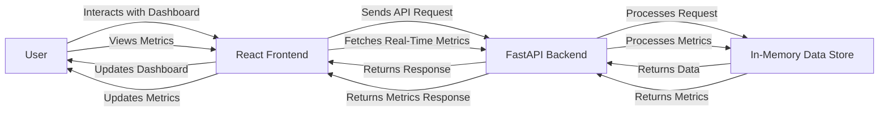

# Executive Summary
The ram-weather-optimizer-pro-max-plus project aims to optimize Windows 11's built-in Weather app RAM usage with real-time metrics and interactive dashboards. The project utilizes a FastAPI backend, a React frontend, and Tailwind CSS for styling.

## Architecture Overview
The project consists of two main components: the FastAPI backend and the React frontend. The FastAPI backend handles API requests, stores data in-memory, and provides real-time metrics. The React frontend interacts with the backend API, displays metrics, and provides an interactive dashboard.

## End-to-End System Architecture Flow Diagram

## API Contracts
The FastAPI backend provides the following API endpoints:

* `POST /data`: Submit data to the in-memory data store
* `GET /data`: Retrieve data from the in-memory data store
* `POST /reset`: Reset the in-memory data store
* `GET /metrics`: Retrieve real-time metrics

## Frontend Component Architecture
The React frontend consists of the following components:

* `App`: The main application component
* `Dashboard`: The dashboard component that displays metrics and provides an interactive interface
* `Metrics`: The metrics component that displays real-time metrics

## Automated Testing Setup
The project uses Pytest for automated testing. The tests cover the following scenarios:

* Successful API calls
* Validation errors
* In-memory state modifications

## Step-by-Step Local Running Instructions
To run the project locally, follow these steps:

1. Install backend packages: `pip install -r requirements.txt`
2. Start the backend: `uvicorn backend.app:app --reload --port 8000`
3. Install frontend packages: `cd frontend && npm install`
4. Start the frontend: `cd frontend && npm run dev`
5. Access the dashboard: `http://localhost:5173`

Note: CORS allows local communication between the React frontend and the FastAPI backend. The FastAPI backend is configured to allow requests from the React dev server (`http://localhost:5173`).