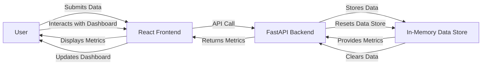

# Executive Summary
The ram-weather-optimizer-pro-max-plus project aims to optimize Windows 11's built-in Weather app RAM usage by providing real-time metrics and interactive dashboards. The project utilizes a FastAPI backend, a React frontend, and Tailwind CSS for styling.

# Architecture Overview
The project consists of two main components: the FastAPI backend and the React frontend. The FastAPI backend handles API requests, stores data in-memory, and provides real-time metrics. The React frontend interacts with the backend through API calls, displays interactive dashboards, and provides a user interface for users to submit data.

## Backend Architecture
The FastAPI backend is designed to handle API requests, store data in-memory, and provide real-time metrics. The backend consists of the following components:
* **API Endpoints**: The backend provides API endpoints for users to submit data, retrieve metrics, and reset the in-memory data store.
* **In-Memory Data Store**: The backend stores data in-memory using global Python list/dictionary variables.
* **CORS Middleware**: The backend uses CORS middleware to allow requests from the React dev server.

## Frontend Architecture
The React frontend interacts with the backend through API calls, displays interactive dashboards, and provides a user interface for users to submit data. The frontend consists of the following components:
* **Components**: The frontend consists of various components, including dashboards, stats cards, forms, and tabs.
* **Lucide React Icons**: The frontend uses Lucide React icons for dashboards, stats cards, forms, and tabs.
* **Dynamic Interactive Forms**: The frontend includes dynamic interactive forms that use `fetch` to submit and load data from the FastAPI backend API.

## End-to-End System Architecture Flow Diagram

# API Contracts
The FastAPI backend provides the following API endpoints:
* **POST /submit**: Submits data to the in-memory data store.
* **GET /metrics**: Retrieves real-time metrics from the in-memory data store.
* **POST /reset**: Resets the in-memory data store.

# Frontend Component Architecture
The React frontend consists of the following components:
* **Dashboard**: Displays interactive dashboards and metrics.
* **StatsCard**: Displays statistics and metrics.
* **Form**: Submits data to the FastAPI backend API.
* **Tab**: Displays tabs for navigation.

# Automated Testing Setup
The project uses pytest for automated testing. The test suite includes tests for API endpoints, in-memory data store, and frontend components.

# Step-by-Step Local Running Instructions
To run the project locally, follow these steps:
1. Install backend packages: `pip install -r requirements.txt`
2. Start the backend: `uvicorn backend.app:app --reload --port 8000`
3. Install frontend packages: `cd frontend && npm install`
4. Start the frontend: `cd frontend && npm run dev`
5. Open the frontend in a web browser: `http://localhost:5173`

# CORS Explanation
CORS (Cross-Origin Resource Sharing) allows the React frontend to make API calls to the FastAPI backend, which is running on a different port. The FastAPI backend uses CORS middleware to allow requests from the React dev server. This enables local communication between the frontend and backend.