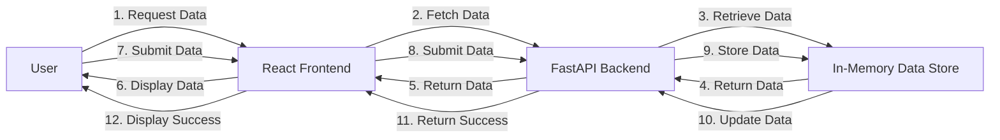

# Executive Summary
The ram-weather-optimizer-pro-max-plus project aims to optimize Windows 11's built-in Weather app RAM usage with real-time metrics and interactive dashboards. The project utilizes a FastAPI backend, a React frontend, and Tailwind CSS for styling.

# Architecture Overview
The project consists of two main components: the FastAPI backend and the React frontend. The FastAPI backend handles API requests, stores data in-memory, and provides real-time metrics. The React frontend provides an interactive dashboard for users to view and interact with the data.

## Backend Architecture
The FastAPI backend is designed to handle API requests, store data in-memory, and provide real-time metrics. The backend consists of the following components:

* **API Endpoints**: The backend provides API endpoints for users to interact with the data. The endpoints include:
	+ `POST /data`: Submit data to the backend
	+ `GET /data`: Retrieve data from the backend
	+ `POST /reset`: Reset the in-memory data store
* **In-Memory Data Store**: The backend stores data in-memory using global Python list/dictionary variables. The data is appended to these variables on POST requests and retrieved on GET requests.

## Frontend Architecture
The React frontend provides an interactive dashboard for users to view and interact with the data. The frontend consists of the following components:

* **Dashboard**: The dashboard displays real-time metrics and data from the backend.
* **Forms**: The frontend includes dynamic interactive forms that use `fetch` to submit and load data from the backend API.
* **System Logs Visualizer**: The frontend includes a system logs visualizer to display logs from the backend.

## End-to-End Flow Diagram

# API Contracts
The FastAPI backend provides the following API endpoints:

* `POST /data`: Submit data to the backend
	+ Request Body: `{"key": "string", "value": "string"}`
	+ Response: `{"message": "Data submitted successfully"}`
* `GET /data`: Retrieve data from the backend
	+ Response: `[{"key": "string", "value": "string"}]`
* `POST /reset`: Reset the in-memory data store
	+ Response: `{"message": "Data store reset successfully"}`

# Frontend Component Architecture
The React frontend consists of the following components:

* **Dashboard**: Displays real-time metrics and data from the backend
* **Forms**: Dynamic interactive forms that use `fetch` to submit and load data from the backend API
* **System Logs Visualizer**: Displays logs from the backend

# Automated Testing Setup
The project uses Pytest for automated testing. The tests cover the following scenarios:

* Successful API calls
* Validation errors
* In-memory state modifications

# Step-by-Step Local Running Instructions
To run the project locally, follow these steps:

1. Install backend packages: `pip install -r requirements.txt`
2. Start the backend: `uvicorn backend.app:app --reload --port 8000`
3. Install frontend packages: `cd frontend && npm install`
4. Start the frontend: `cd frontend && npm run dev`
5. Open the frontend in a web browser: `http://localhost:5173`

Note: CORS allows local communication between the frontend and backend. The frontend makes requests to the backend, which responds with the requested data.