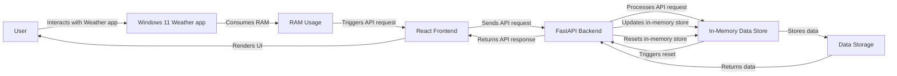

# ram-weather-optimizer-pro-max-plus

## Executive Overview
The ram-weather-optimizer-pro-max-plus project aims to optimize Windows 11's built-in Weather app RAM usage with real-time metrics and interactive dashboards. This project utilizes FastAPI, Python, React (Vite), and TailwindCSS to provide a comprehensive solution.

## Feature Breakdown
* Real-time metrics and interactive dashboards for Windows 11 Weather app RAM usage
* FastAPI backend for handling API requests and storing data in-memory
* React frontend with Vite and TailwindCSS for a modern and responsive UI
* Automated testing setup using pytest for ensuring API endpoint functionality

## API Contract Summary
The FastAPI backend exposes the following API endpoints:
* `POST /data`: Submit data to the in-memory store
* `GET /data`: Retrieve data from the in-memory store
* `POST /reset`: Reset the in-memory data store

## End-to-End System Architecture Flow Diagram

## Step-by-Step Commands
### Backend
1. Install packages: `pip install -r requirements.txt`
2. Start the backend: `uvicorn backend.app:app --reload --port 8000`

### Frontend
1. Setup: `cd frontend && npm install`
2. Start the frontend: `npm run dev`

### CORS
CORS (Cross-Origin Resource Sharing) allows the React frontend to communicate with the FastAPI backend running on a different port. This is enabled in the FastAPI backend using the `CORSMiddleware`.

## Running the Project
To run the project, follow the step-by-step commands above. The React frontend will be available at `http://localhost:5173`, and the FastAPI backend will be available at `http://localhost:8000`. The frontend will send API requests to the backend, which will process the requests and return responses. The in-memory data store will be updated accordingly.